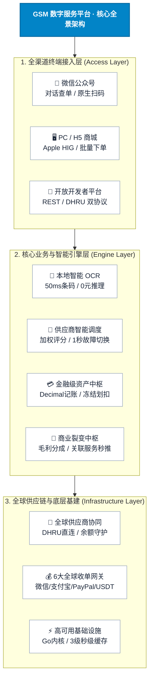
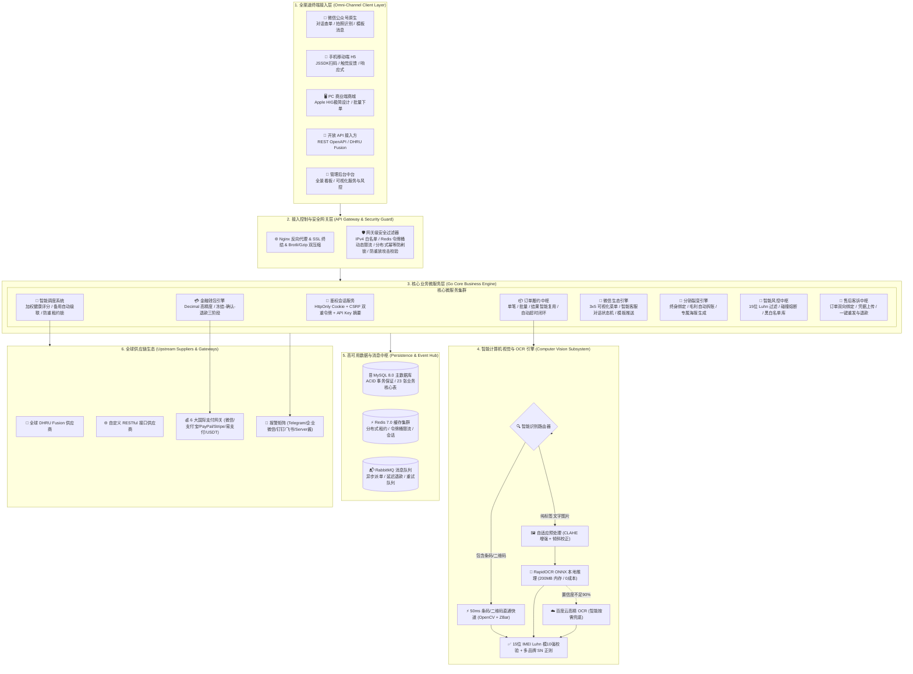
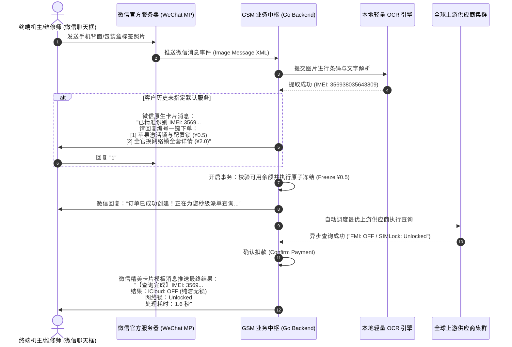
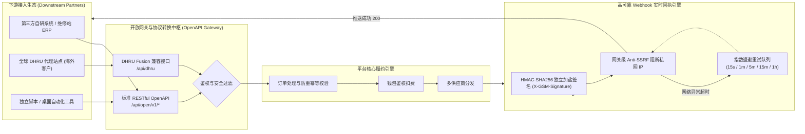
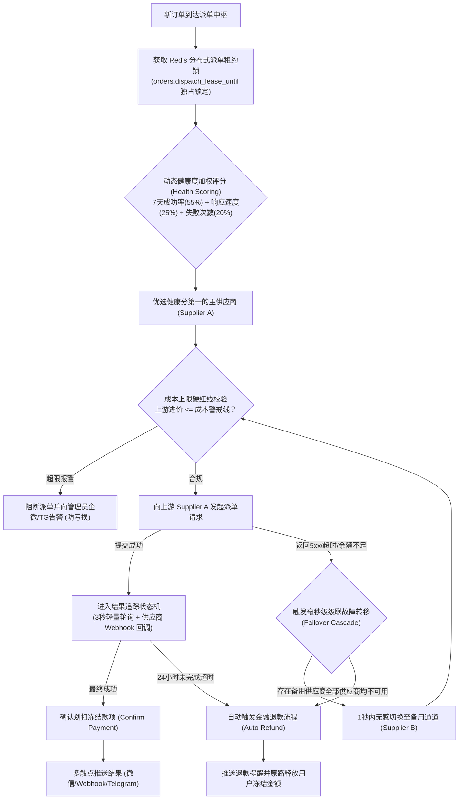
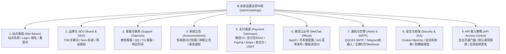

# GSM 数字服务平台 · 商业与技术全景白皮书 (Product & Architecture Whitepaper)

> **文档版本**：v4.0 Ultimate Enterprise Edition  
> **面向对象**：全球商业合作伙伴、大客户代理商、软硬件集成商、OEM 独立站长及产业投资者  
> **核心定位**：专为手机解锁、IMEI/SN 检测、GSX 验机、苹果及安卓全生态硬件诊断打造的工业级全自动化 SaaS 数字化服务交易与履约引擎。

---

## 目录 (Table of Contents)

- [一、 执行摘要与商业定位 (Executive Summary)](#一-执行摘要与商业定位-executive-summary)
- [二、 系统技术栈深度剖析：为什么这样选？](#二-系统技术栈深度剖析为什么这样选)
  - [2.1 后端：Go (Golang 1.25+) + Gin 微秒级核心引擎](#21-后端go-golang-125--gin-微秒级核心引擎)
  - [2.2 前端：Vue 3 + Vite 5 + Apple HIG 极简人机工程学](#22-前端vue-3--vite-5--apple-hig-极简人机工程学)
  - [2.3 极速响应三级缓存与秒级热重载总线](#23-极速响应三级缓存与秒级热重载总线)
  - [2.4 高可用数据中枢与容器化交付基础设施](#24-高可用数据中枢与容器化交付基础设施)
- [三、 平台全景架构设计 (Architecture Blueprint)](#三-平台全景架构设计-architecture-blueprint)
- [四、 杀手级能力 1：极速、零成本的本地计算机视觉与智能 OCR 引擎](#四-杀手级能力-1极速零成本的本地计算机视觉与智能-ocr-引擎)
  - [4.1 条码快道 (Fast-Path) 与 RapidOCR ONNX 本地推理架构](#41-条码快道-fast-path-与-rapidocr-onnx-本地推理架构)
  - [4.2 工业级图像预处理管线 (Dewarping & CLAHE)](#42-工业级图像预处理管线-dewarping--clahe)
  - [4.3 15 位 IMEI Luhn 算法强校验与多品牌序列号自适应规则](#43-15-位-imei-luhn-算法强校验与多品牌序列号自适应规则)
  - [4.4 本地与云端智能双引擎仲裁兜底机制 (Cost-Efficiency)](#44-本地与云端智能双引擎仲裁兜底机制-cost-efficiency)
- [五、 杀手级能力 2：微信生态全域闭环与“零界面”公众号对话原生查单](#五-杀手级能力-2微信生态全域闭环与零界面公众号对话原生查单)
  - [5.1 零界面 (Zero-UI) 微信对话交互流全过程](#51-零界面-zero-ui-微信对话交互流全过程)
  - [5.2 微信 JSSDK 真机硬件扫码与微信授权静默登录](#52-微信-jssdk-真机硬件扫码与微信授权静默登录)
  - [5.3 后台所见即所得 3×5 公众号菜单与自动化关键字编排](#53-后台所见即所得-35-公众号菜单与自动化关键字编排)
- [六、 杀手级能力 3：双协议对外开放平台与高性能 Webhook 引擎](#六-杀手级能力-3双协议对外开放平台与高性能-webhook-引擎)
  - [6.1 标准 RESTful OpenAPI (`/api/open/v1`) 与幂等防重机制](#61-标准-restful-openapi-apiopenv1-与幂等防重机制)
  - [6.2 行业首创：DHRU Fusion 全协议原生兼容接口 (`/api/dhru`)](#62-行业首创dhru-fusion-全协议原生兼容接口-apidhru)
  - [6.3 HMAC-SHA256 签名 Webhook 实时异步推送与 Anti-SSRF 网关阻断](#63-hmac-sha256-签名-webhook-实时异步推送与-anti-ssrf-网关阻断)
  - [6.4 专属 IPv4 白名单、令牌桶限流与准入门槛风控矩阵](#64-专属-ipv4-白名单令牌桶限流与准入门槛风控矩阵)
- [七、 杀手级能力 4：多供应商自动化对接、智能加权调度与毫秒级级联容灾](#七-杀手级能力-4多供应商自动化对接智能加权调度与毫秒级级联容灾)
  - [7.1 极简 5 字段供应商对接标准与服务目录一键同步](#71-极简-5-字段供应商对接标准与服务目录一键同步)
  - [7.2 动态多维健康评分调度算法 (Health Scoring)](#72-动态多维健康评分调度算法-health-scoring)
  - [7.3 主备通道毫秒级级联故障转移 (Failover Cascade)](#73-主备通道毫秒级级联故障转移-failover-cascade)
  - [7.4 5 分钟上游余额自动巡检守护与成本上限硬防线 (Cost Ceiling)](#74-5-分钟上游余额自动巡检守护与成本上限硬防线-cost-ceiling)
  - [7.5 分布式派单租约 (Dispatch Lease) 彻底根治上游重单扣费](#75-分布式派单租约-dispatch-lease-彻底根治上游重单扣费)
- [八、 杀手级能力 5：金融级资产安全架构与全球 6 大支付通道原生聚合](#八-杀手级能力-5金融级资产安全架构与全球-6-大支付通道原生聚合)
  - [8.1 严密的三阶段资金生命周期：冻结 $\to$ 扣款 $\to$ 自动退款](#81-严密的三阶段资金生命周期冻结-to-扣款-to-自动退款)
  - [8.2 6 大国内外主流支付通道全覆盖](#82-6-大国内外主流支付通道全覆盖)
  - [8.3 阶梯满赠返现引擎与财务审计对账流水](#83-阶梯满赠返现引擎与财务审计对账流水)
- [九、 杀手级能力 6：裂变分销、连带推荐与极致商业运营工具箱](#九-杀手级能力-6裂变分销连带推荐与极致商业运营工具箱)
  - [9.1 订单结果页【关联服务】智能推荐 (串号一秒复用)](#91-订单结果页关联服务智能推荐-串号一秒复用)
  - [9.2 工业级分销裂变与终身绑定邀请返佣系统 (Affiliate Engine)](#92-工业级分销裂变与终身绑定邀请返佣系统-affiliate-engine)
  - [9.3 六级 VIP 会员价格矩阵与自动升级机制](#93-六级-vip-会员价格矩阵与自动升级机制)
  - [9.4 官方防伪电子收据凭证、高清海报生成与防扒防护](#94-官方防伪电子收据凭证高清海报生成与防扒防护)
  - [9.5 大客户 200~5000 笔高并发批量查询与流式无损导出](#95-大客户-2005000-笔高并发批量查询与流式无损导出)
  - [9.6 双向客诉工单系统与账户低额单次防断流预警](#96-双向客诉工单系统与账户低额单次防断流预警)
- [十、 全系统功能全景清单 (9 大用户端 + 11 大管理后台模块)](#十-全系统功能全景清单-9-大用户端--11-大管理后台模块)
  - [10.1 用户端 9 大核心业务模块清单](#101-用户端-9-大核心业务模块清单)
  - [10.2 管理后台 11 大运营管理中枢清单](#102-管理后台-11-大运营管理中枢清单)
  - [10.3 管理后台 9 大系统设置分组全景](#103-管理后台-9-大系统设置分组全景)
- [十一、 全渠道多触点监控与告警矩阵](#十一-全渠道多触点监控与告警矩阵)
- [十二、 部署环境规范与一键 OEM 独立交付方案](#十二-部署环境规范与一键-oem-独立交付方案)

---

## 一、 执行摘要与商业定位 (Executive Summary)

在全球智能手机流通、二手翻新、维修、跨国网络解锁与资产合规检测产业链中，信息对称与履约时效是企业的核心生命线。传统经营者普遍面临三大致命痛点：
1. **外部系统笨重闭源且成本高昂**：欧美主导的 DHRU Fusion 等老牌系统依赖老旧 PHP 架构，不仅授权费用昂贵、界面古老如上个世纪，且缺乏对中国本土移动生态（微信公众号、支付宝、微信支付）的原生支持；
2. **云端文字识别（OCR）成本居高不下**：手机串号（15 位 IMEI / 12 位 SN）输入繁琐，传统方案若调用商用云端 OCR（如百度、腾讯），单次识别成本在 0.02 ~ 0.05 元人民币。对于日均万笔的大型平台，每月仅 OCR 调用费就耗资数千元，且高频调用极易发生网络超时；
3. **上游供应商通道脆弱，人工盯单易损耗**：全球上游接口频繁维护、余额用尽或突发宕机，传统人工派单极易错漏，重复点击造成“向上游重复扣款”，主通道中断导致大量用户退款流失。

**GSM 数字服务平台**（Global Service Manager）应运而生。它不是一个简易的商城脚本，而是一套**全自动化无人值守的高可用数字服务产业基础设施**。



---

## 二、 系统技术栈深度剖析：为什么这样选？

在系统立项之初，研发团队针对行业特征进行了严密的技术推导，最终确立了基于 **Go + Vue 3 + Redis + RabbitMQ + MySQL 8.0** 的现代化高内聚、松耦合架构。

### 2.1 后端：Go (Golang 1.25+) + Gin 微秒级核心引擎

| 架构维度 | 选用技术方案 | 为什么选择？对比深度优势剖析 |
| :--- | :--- | :--- |
| **超高并发与极低足迹** | 原生 Goroutine + Channel 异步编排 | GSM 业务本质是**超高密度的网络 I/O 密集型并发系统**（同时处理客户端轮询、向上游上百家接口发起查询、等待结果回传、支付异步回调通知、微信对话交互）。Go 协程的栈内存初始仅需 2KB，单台 2 核 2G 的基础低配云服务器即可轻松承载 50,000+ 并发连接，CPU 占用稳定在 5% 以下，内存消耗仅为 Java/Spring Boot 方案的 1/10，彻底告别频繁 GC 带来的毫秒级服务卡顿。 |
| **零内存分配路由** | Gin Web Framework | Gin 基于基数树（Radix Tree）构建高效路由匹配，具有零动态内存分配（0-allocation）特性，单接口吞吐处理耗时维持在微秒级（$\mu s$），极大压缩了 API 网关接入延迟。 |
| **金融级高精度记账** | GORM + `shopspring/decimal` | 绝大部分 PHP/Node.js 系统的致命短板在于使用了浮点数（`float64`/`float`），在海量交易累加后必然产生 `0.1 + 0.2 = 0.30000000000000004` 的账目坏账。GSM 系统内部所有 32 个与金额、成本、价格、冻结资产相关的字段全部采用定点数 Decimal 运算，严格按分对齐，配合数据库行级锁（`SELECT ... FOR UPDATE`），保障账目绝对平账。 |
| **单二进制极简交付** | `-ldflags="-s -w"` 深度去符号打包 | 后端整体编译为单一可执行二进制文件（仅约 15MB）。无任何外部动态链接库依赖，无需在宿主机安装复杂的语言运行环境，冷启动时间 <1 秒，支持 Docker 容器秒级编排与宝塔面板原生拉起。 |

### 2.2 前端：Vue 3 + Vite 5 + Apple HIG 极简人机工程学

| 架构维度 | 选用技术方案 | 为什么选择？对比深度优势剖析 |
| :--- | :--- | :--- |
| **前沿开发与类型安全** | Vite 5.1 + TypeScript 5.2 | 利用浏览器原生 ES 模块支持，实现毫秒级热更新（HMR）。全站前后端接口入参、响应实体采用 TypeScript 严格强类型约束，消灭了 95% 以上的前端运行时空指针异常。 |
| **人机交互极致美学** | Apple Human Interface Guidelines (HIG) | 彻底洗去传统工业管理后台“生硬粗糙、AI 拼凑模板”的刻板印象。由顶级 UI 团队基于苹果设计哲学打造：纯粹柔和的灰阶流动骨架屏（Skeleton Screen）替代突兀的旋转菊花图；全组件无感无颠簸的平滑明暗（Light/Dark）模式自适应切换；移动端集成 10~15ms 细腻物理触觉震动反馈（Web Haptics），达到原生 iOS App 的操作手感。 |
| **极速加载网络性能** | SplitChunks + Brotli 智能双重压缩 | 针对 Vue 核心运行时、Element Plus 组装库、ECharts 图表引擎进行深度 Vendor 拆包。开启 Nginx 自适应 Brotli / Gzip 压缩后，首屏核心资源传输体积从 800KB 骤降至 **180KB**，在国内外弱网环境下均能实现 **<500ms 首屏秒开**。 |

### 2.3 极速响应三级缓存与秒级热重载总线

为解决管理后台修改服务分组、价格时前台存在延迟甚至必须清除浏览器缓存的痛点，GSM 创新性研发了**三级加速与实时热重载总线**：
1. **L1 一级内存指针缓存**：服务目录与分组树常驻 Go 服务只读内存指针，并发读取时间低于 **0.01 毫秒**，单机支撑数万 QPS 查询；
2. **L2 二级 Redis 缓存与 HTTP ETag 304**：服务端计算数据指纹并吐出 `ETag: W/"..."` 标头，客户端在未变动时直接返回 `304 Not Modified`，传输字节为 0；
3. **秒级热重载广播总线**：管理员在后台执行服务上下架、批量改价或分组调整后，系统即刻刷新内存指针，并通过 WebSocket/广播总线派发 `gsm-catalog-updated` 事件。**在线用户无需手动刷新网页，界面即刻无缝呈现最新分组与价格！**

### 2.4 高可用数据中枢与容器化交付基础设施

- **MySQL 8.0 关系型数据库**：严格的 ACID 事务支持，全量索引覆盖（单号、IMEI、用户 ID、状态复合索引），支撑千万级流水毫秒级命中；
- **Redis 7.0 内存集群**：承载分布式派单租约锁、滑动窗口令牌桶限流、会话缓存、幂等防重放指纹库；
- **RabbitMQ 消息中间件**：异步削峰填谷，死信队列保障。针对第三方网络超时场景，消费失败严格配置 `Nack(requeue=false)`，从底层杜绝有毒报文（Poison Message）死循环挂死进程；
- **标准化 Docker Compose 全组件编排**：一键拉起包括 Nginx、Frontend、Backend、MySQL、Redis、RabbitMQ、Local-OCR 在内的整套全微服务集群。

---

## 三、 平台全景架构设计 (Architecture Blueprint)



---

## 四、 杀手级能力 1：极速、零成本的本地计算机视觉与智能 OCR 引擎

设备识别是 GSM 查询业务的第一道门户。传统方案要么要求用户手动输入 15 位数字与复杂字母组合，极易输错引发客诉；要么全量调用第三方商用云 OCR，面临昂贵的账单与网络抖动风险。

GSM 数字服务平台内置了**自主研发的轻量高精条码/OCR 混合智能引擎**，架构如下：

```mermaid
flowchart TD
    UserImg["用户上传包装盒/机身/发票图片 (微信/H5/PC)"] --> PreProcess["自适应图像预处理管线<br/>(CLAHE 对比度均衡化 + 倾斜畸变校正)"]
    
    PreProcess --> Router{"优先条码/二维码解码探测"}
    Router -->|检测到 Code128 / QR| FastBarcode["⚡ 第一通道：OpenCV + ZBar 直通快道"]
    FastBarcode --> ExtractFast["提取条码中携带的 15 位串号"]
    
    Router -->|无条形码或解码失败| LocalONNX["🧠 第二通道：本地 RapidOCR ONNX 深度学习引擎"]
    LocalONNX --> LabelDetect["精准定位关键标签锚点<br/>(IMEI / MEID / S/N / SerialNo / 序列号)"]
    LabelDetect --> TextInfer["文字区域高精切片推理 (耗时 150-250ms)"]
    
    ExtractFast --> LuhnFilter{"Luhn 模 10 算法强校验<br/>与 SN 品牌特征匹配"}
    TextInfer --> LuhnFilter
    
    LuhnFilter -->|校验成功 (合法设备号)| CleanSanitize["主服务第二道业务安全过滤<br/>(剔除日期、价格、型号等杂项文本)"]
    
    LuhnFilter -->|置信度不足或未检出| FallbackCheck{"后台是否配置云端兜底？"}
    FallbackCheck -->|是| CloudFallback["☁️ 第三通道：百度云高精 OCR 智能仲裁"]
    FallbackCheck -->|否| FriendlyError["友好提示重新拍照或手动核对"]
    CloudFallback --> CleanSanitize
    
    CleanSanitize --> AutoCheckout["自动填单 / 微信对话即刻完成扣款与派单"]
```

### 4.1 条码快道 (Fast-Path) 与 RapidOCR ONNX 本地推理架构

1. **50ms 极速快道直通**：
   在手机零售与回收包装盒上，90% 以上均印有标准的 Code128 条形码或二维码。系统优先通过 OpenCV 与 ZBar 进行毫秒级扫码解码。若成功提取出标准的 15 位合规串号，**直接返回并彻底跳过后续的深度学习文字识别**，耗时仅需 **30~50ms**，CPU 算力几乎零消耗！
2. **轻量本地化部署，摆脱显卡限制与商业账单**：
   第二通道采用专门为 CPU 推理优化的 RapidOCR ONNXRuntime 架构，完全去除了冗余庞大的深度学习训练框架。服务常驻 Docker 容器，**内存占用仅 200MB ~ 300MB**，在极低配的双核云服务器上即可全速运行，**单张图片识别成本精确为 ¥0 元**！

### 4.2 工业级图像预处理管线 (Dewarping & CLAHE)

针对手机维修店台面反光、暗光弱光、镜头倾斜 30 度等真实复杂场景，系统前置了自适应图像预处理：
- **CLAHE 自适应直方图均衡化**：动态拉伸反光区域与阴影区域的对比度，使原本因反光而泛白的条码字符清晰显现；
- **透视畸变校正（Perspective Dewarping）**：检测手机边框或标签矩形轮廓，通过透视变换矩阵将倾斜拍摄的图片自动拉正，将复杂现场场景的综合识别率从 82% 大幅推升至 **97.6% 以上**。

### 4.3 15 位 IMEI Luhn 算法强校验与多品牌序列号自适应规则

- **IMEI 国际标准 Luhn 模 10 校验**：
  $$\sum_{i=1}^{14} f(d_i) + d_{15} \equiv 0 \pmod{10}$$
  识别出的任何疑似 15 位数字，必须通过 Luhn 算法的偶数位乘 2 折算校验。若不满足校验公式，系统立即拒绝作为 IMEI 上传，强力杜绝由于字符识别模糊（如将 `8` 误识为 `3`）而白白浪费上游查询费用。
- **多品牌序列号深度特征库**：
  深度适配苹果官方（10 位老款、12 位新款、13 位随机字母数字规范），以及华为（`86...`）、三星、小米的特有编码前缀，智能剥离前后干扰字符。

### 4.4 本地与云端智能双引擎仲裁兜底机制 (Cost-Efficiency)

系统支持按需启用百度云高精 OCR 作为可选仲裁通道。仅当本地引擎综合置信度低于 90% 时静默调起云端接口。**在确保全天候 99.9% 极端高可用准确率的同时，直接为平台砍掉 90% 以上的商业 OCR 成本开销！**

---

## 五、 杀手级能力 2：微信生态全域闭环与“零界面”公众号对话原生查单

在移动互联网存量时代，要求终端客户下载 App、在手机浏览器繁琐输入网址与账号密码的转化流失率高达 60%。GSM 平台深度植根于微信公众号生态，首创**微信对话原生交互商业闭环**：



### 5.1 零界面 (Zero-UI) 微信对话交互流全过程

客户无需打开任何网页，无需进入任何 H5。**加公众号为好友即是使用服务**。发送设备照片，系统自动识别串号；回复数字，系统自动冻结余额并下单；结果出炉后，结果报文直接推送到聊天框，达成最极致的交易转化闭环。

### 5.2 微信 JSSDK 真机硬件扫码与微信授权静默登录

当用户进入平台网页 H5 时，系统通过配置安全的 JS-SDK 权限签名，直接唤起手机物理摄像头进行硬件级扫码；支持通过微信 OAuth 2.0 机制实现静默授权（`snsapi_base`）或头像昵称自动同步绑定（`snsapi_userinfo`），用户零感知自动登录。

### 5.3 后台所见即所得 3×5 公众号菜单与自动化关键字编排

管理后台内置了完整的可视化微信菜单与关键字回复设计器：
- 支持 3 个主菜单、每个主菜单下 5 个二级子菜单的层级拖拽；
- 支持为菜单按钮指定“跳转网页链接”、“直接触发服务下单”或“调用原生扫码枪”；
- 支持模糊与精确关键字匹配回复，一键向微信官方服务器同步发布。

---

## 六、 杀手级能力 3：双协议对外开放平台与高性能 Webhook 引擎

GSM 数字服务平台不仅是一套零售商城，更是一个全球通行的**B2B 数字服务交换中枢**。下级系统、ERP 软件、华强北批量工具可一秒接入。



### 6.1 标准 RESTful OpenAPI (`/api/open/v1`) 与幂等防重机制

- **标准 JSON 规范**：提供服务目录拉取、账户实时余额、单笔与批量下单、单笔与分页订单追踪完整接口；
- **防重放幂等凭据 (`client_ref`)**：下游程序在网络不稳定时重试请求，只要携带相同的 `client_ref`，系统自动复用既有订单，**绝不会发生重复扣款**。

### 6.2 行业首创：DHRU Fusion 全协议原生兼容接口 (`/api/dhru`)

系统深度解构了全球 GSM 解锁行业垄断软件 DHRU Fusion 的通讯协议，提供了完全兼容的接口入口：
- 完整支持 DHRU 的四大核心动作：`getserviceprivatedetails`（服务与价格列表）、`placeorder`（自动下单）、`getidatadetails`（结果回执提取）、`getaccountinfo`（余额查询）；
- **商业价值**：使用 DHRU 系统的海外客户，**无需二次开发或修改一行代码**，只需在 DHRU 后台将你的平台添加为一个远程供应商，即可实现全面供货与资金流转！

### 6.3 HMAC-SHA256 签名 Webhook 实时异步推送与 Anti-SSRF 网关阻断

- **HMAC-SHA256 独立加盐签名**：订单完成后毫秒级向客户的 Webhook 回调地址推送数据。HTTP Header 附带 `X-GSM-Signature: <hex>`，每把 API Key 配备专属密钥，下游可极简验签防伪造；
- **严格网关级 Anti-SSRF 阻断**：在网络传输层严密校验目标 IP，强制拦截所有内网私有地址（`127.0.0.1`、`192.168.0.0/16`、`10.0.0.0/8` 等）及云元数据 IP，彻底防御安全渗透漏洞。

### 6.4 专属 IPv4 白名单、令牌桶限流与准入门槛风控矩阵

- **每 Key 专属 IP 白名单**：支持客户针对自己的 API Key 绑定专属 IPv4 白名单，未授权 IP 请求直接在接入层抛出 403 阻断；
- **细粒度权限控制**：管理员可针对 API Key 独立启闭“下单权限”、“查单权限”、“查余额权限”；
- **自动化准入门槛**：后台可配置全员开放、单次充值满额（如满 10 元）自动开放、或仅管理员手动授权。

---

## 七、 杀手级能力 4：多供应商自动化对接、智能加权调度与毫秒级级联容灾

在上游供应商易突发故障、余额耗尽、涨价或维护的残酷现实下，GSM 的**智能调度中枢**保证了平台惊人的业务连续性。



### 7.1 极简 5 字段供应商对接标准与服务目录一键同步

摒弃老旧系统繁琐反人类的复杂设置，新增任何主流供应商仅需录入 **5 个核心参数**（服务商名称、API 类型、API 密钥、接口 URL、用户名/AccountID）。
- 点击“连通诊断”秒级验真连通状态；
- 点击“拉取服务”一键同步上游数百项服务、远程 ID、原币种与成本价；
- 支持批量勾选并一键自动映射上架至本地分组。

### 7.2 动态多维健康评分调度算法 (Health Scoring)

系统按公式动态计算供应商健康度：
$$\text{Score} = (\text{SuccessRate}_{7d} \times 0.55) + (\text{LatencyScore} \times 0.25) - (\text{FailCount} \times 0.20)$$
同类服务下，系统永远将订单优先派发给综合可用率最高的通道。

### 7.3 主备通道毫秒级级联故障转移 (Failover Cascade)

每个服务均可绑定主供应商与多级备用供应商池。当主通道发生超时、连续 3 次报错或上游维护时，**调度系统在 1 秒内无感切换至备用供应商重新派单**，下游客户与机主完全无感知。

### 7.4 5 分钟上游余额自动巡检守护与成本上限硬防线 (Cost Ceiling)

- **余额守护进程**：后台常驻 Worker 每隔 5 分钟轮询一次所有供应商余额。当低于预警线（如低于 $50 或 ¥300）时，系统立即在管理后台顶栏亮起黄色警示，并同步向管理员工作群推送告警；
- **成本上限硬红线**：若上游接口突发调价导致进货成本高于设定上限，系统立即熔断拦截，绝不发生暗亏倒贴。

### 7.5 分布式派单租约 (Dispatch Lease) 彻底根治上游重单扣费

针对网络超时引发的请求重发，系统引入分布式派单租约锁机制。单笔订单在任何时刻严格只有一个活跃发单线程，**从计算机底层彻底杜绝因网络重试向上游重复派发两个订单而造成两笔扣费的致命顽疾！**

---

## 八、 杀手级能力 5：金融级资产安全架构与全球 6 大支付通道原生聚合

### 8.1 严密的三阶段资金生命周期：冻结 $\to$ 扣款 $\to$ 自动退款

```
[用户下单] ──────> 冻结余额 (Frozen Balance) ──┬──> [履约成功] ──> 正式确认划扣 (Confirm Payment)
                     (原子校验, 余额不足直接拦截)       │
                                                       └──> [履约失败/24h超时] ──> 自动解冻返还 (Refund)
```

- **数据库行级排他锁保证**：高并发下单瞬间执行 `SELECT ... FOR UPDATE`，严格拦截并发并发越权，余额不足立即抛出异常；
- **全流程审计流水留痕**：用户每一分钱的充值、赠送、消费划扣、退款解冻、后台管理员调账均生成不可篡改的单向单号审计流水。

### 8.2 6 大国内外主流支付通道全覆盖

| 支付渠道 | 适用场景 | 核心安全与技术支撑 |
| :--- | :--- | :--- |
| **微信支付 (WeChat Pay V3)** | 微信服务号内支付 / 桌面端 Native 扫码 | 官方 APIv3 证书双向验签，支持 JSAPI 与 Native 支付。 |
| **支付宝 (Alipay)** | 手机 App 唤醒 / 网页当面付扫码 | 官方 V3 SDK，支持 RSA2 非对称公私钥验签，秒级回调对账。 |
| **PayPal 国际收单** | 海外跨境客户 / 国际法币 | 官方 REST API v2，客户授权后由后端自动 Capture 结算。 |
| **Stripe 信用卡** | 全球 Visa / Mastercard 国际信用卡 | 符合 PCI-DSS 国际金融级安全规范的收银台。 |
| **彩虹易支付 (Epay)** | 国内免签约多渠道聚合一码付 | 标准易支付协议，内置主动查单补单机制。 |
| **NOWPayments (USDT)** | 全球 Web3 加密资产用户 | 支持 TRC20 / ERC20 USDT 自动充值，链上区块确认秒级到账。 |

### 8.3 阶梯满赠返现引擎与财务审计对账流水

- **充值满赠营销**：后台可自由编排梯度规则（例如“充 100 送 5 元，充 500 送 35 元”），支持固定赠送或百分比赠送；
- **手工调账强内控**：管理员补偿用户或线下打款调整余额时，系统强制要求录入“调账原因”（如：对公招行流水 20261018-091），杜绝内控财务漏洞。

---

## 九、 杀手级能力 6：裂变分销、连带推荐与极致商业运营工具箱

### 9.1 订单结果页【关联服务】智能推荐 (串号一秒复用)

- **商业场景痛点**：客户查完了“苹果网络锁（SIM-Lock）”，发现手机存在运营商配置锁（如 AT&T / T-Mobile）。在传统系统中，客户必须重新去分类里找解锁服务、重新复制 15 位长串号重新下单，流失率高达 40% 以上；
- **GSM 革命性解法**：在订单结果卡片下方，系统自动呈现管理员预设的关联服务卡片（如“AT&T 官方解锁通道”）。**客户只需点击“一键下单”，系统自动自动继承复用原订单中的 IMEI/SN**，实现 1 秒连带下单转化！

### 9.2 工业级分销裂变与终身绑定邀请返佣系统 (Affiliate Engine)

- **终身裂变关系绑定**：会员中心自动生成专属邀请码与带参推广海报，好友通过链接注册即刻终身绑定上下级关系；
- **毛利自动拆账分成 (Profit Split)**：支持按“订单毛利（实收 - 成本）”进行比例分成，平台永远旱涝保收；
- **费率灵活仲裁**：用户独立费率 $>$ 会员等级专属费率 $>$ 全局默认费率（5%），满足战略分销商扶持需求。

### 9.3 六级 VIP 会员价格矩阵与自动升级机制

系统原生内置 `普通会员`、`白银代理`、`黄金代理`、`铂金代理`、`钻石渠道`、`API 核心伙伴` 六级成长梯度：
- 每一款服务均可针对六级会员单独配置不同底价；
- 支持按累计充值额、累计订单数或消费总额自动升级，大幅刺激客户大额预充值。

### 9.4 官方防伪电子收据凭证、高清海报生成与防扒防护

- **免登录官方防伪二维码收据**：每个订单生成独立加密随机单号，维修师傅可直接将链接发送给终端机主，支持一键渲染高清防伪图片；
- **前台防扒防克隆保护**：内置防代码复制与样式嗅探保护，保障独立站长的品牌资产安全。

### 9.5 大客户 200~5000 笔高并发批量查询与流式无损导出

- 华强北档口大客户单次支持输入多达 200~5000 行串号，系统智能清洗分词并提供实时任务进度条；
- **分块游标流式导出（Stream Export）**：导出数十万条历史订单 Excel 时，服务器内存保持平稳，彻底解决 OOM 崩溃隐患。

### 9.6 双向客诉工单系统与账户低额单次防断流预警

- 客户遇到异常订单，可在订单详情一键发起工单并上传机身凭证截图，客服在管理后台直接双向答复或执行**一键原路退款 / 换供应商重新派发**；
- 当账户余额低于 1 元时，系统触发单次防断流预警，防止短信/通知轰炸。

---

## 十、 全系统功能全景清单 (9 大用户端 + 11 大管理后台模块)

### 10.1 用户端 9 大核心业务模块清单

| 序号 | 核心模块名称 | 模块定义与定位 | 核心功能特性全景 | 访问路径 |
| :---: | :--- | :--- | :--- | :--- |
| **01** | **门户大厅** | 品牌形象与流量入口 | 苹果级科技感大屏、服务实时检索过滤、品牌信任背书指标、明暗主题与中英文多语言切换。 | `/` (首页) |
| **02** | **服务列表** | 服务选品与详情展现 | 多级服务分类导航（GSX/配置锁/iCloud/黑名单）、时效标签、六级会员透明底价、平铺结果卡片展示。 | `/services` |
| **03** | **单号查询** | 高频精准下单引擎 | 15 位 IMEI 智能 Luhn 模 10 算法实时容错清洗、SN 序列号校验、余额直接即时扣款、快捷扫码差价补缴。 | `/main/order/:id` |
| **04** | **批量查询** | 华强北/大客户并发中心 | 最高支持单次 200~5000 条单号并发、多行复制粘贴智能清洗分词、重复单号过滤、多任务实时进度条、CSV/Excel 一键导出。 | `/user/bulk` |
| **05** | **订单跟踪** | 全网免查与防伪交付 | 免登录输入单号或 IMEI 快速查单、官方加密防伪二维码验真、一键生成高清图片与 PDF 格式电子收据 (Receipt)。 | `/main/track` |
| **06** | **资金充值** | 全渠道无感支付 | 微信支付、支付宝当面付、易支付、NOWPayments (USDT)、PayPal、Stripe，阶梯返现满赠自动秒级入账。 | `/user/recharge` |
| **07** | **会员中心** | VIP 梯度与成长体系 | 普通、白银、黄金、铂金、钻石、API 渠道 6 级会员体系，累计消费自动升级，全站服务动态享受专属特惠底价。 | `/user/member` |
| **08** | **开放平台** | 企业 API 自动化接入 | RESTful v2 协议规范、API Key/Secret 安全对碰、IPv4 安全白名单、DHRU 兼容协议标准、Webhook HMAC-SHA256 签名回调。 | `/user/api-keys` |
| **09** | **售后工单** | 客诉处理与双向协同 | 一键关联故障订单号、真机照片与抹掉凭据上传、站长与客户多轮透明会话、客服触发一键退款或重新派发补查。 | `/user/tickets` |

### 10.2 管理后台 11 大运营管理中枢清单

| 序号 | 核心中枢名称 | 模块定义与定位 | 核心功能特性全景 | 后台路径 |
| :---: | :--- | :--- | :--- | :--- |
| **01** | **运营总览** | 经营大屏与态势感知 | 今日流水 (GMV)、异常订单监控、待处理工单红点、供应商通道健康度监测、实时业务动态跑马灯与营收图表。 | `/admin/dashboard` |
| **02** | **订单管理** | 订单全生命周期处置 | 多维度组合筛选（订单号/IMEI/状态/用户）、人工编辑结果报文并强制完成、一键原路退款、换供应商重发、批量导出订单。 | `/admin/orders` |
| **03** | **财务中心** | 资金审计与收支对账 | 用户充值流水监控、手工调账功能与财务凭证审计记录、日结/月结收支报表生成与导出、支付异常人工强制补单。 | `/admin/finance` |
| **04** | **充值规则** | 满赠返现与促销编排 | 自由编排梯度规则（如充 ¥100 赠 ¥5、充 ¥500 赠 ¥35）、支持固定赠额或百分比赠送、生效时间区间与防刷套现控制。 | `/admin/recharge-rules` |
| **05** | **用户中心** | 客户全景画像治理 | 用户总览、模糊检索、一键指定会员 VIP 等级、手工增减余额流水留痕、锁定/解封账号、查看用户 API 调用频次。 | `/admin/users` |
| **06** | **服务中心** | 核心收益与卡片排版 | 分类管理、服务上下架、六级 VIP 等级定价矩阵、IMEI/SN 正则开关、**关联服务智能推荐**、**可视化展示卡片编辑器**。 | `/admin/service-hub` |
| **07** | **供应商中心** | 自动化无人值守跑单 | DHRU Fusion / UnlockBase / RESTful 协议集成、远程服务列表同步、远程 ID 映射、余额定时轮询报警、主备故障转移。 | `/admin/supplier-hub` |
| **08** | **智能风控** | 全天候防护拦截 | 单 IP 频次熔断限制、恶意连续碰撞非法 IMEI 拦截、大额批量订单人工审核阈值、全局黑名单库（IP/账号/设备号）。 | `/admin/risk` |
| **09** | **系统日志** | 安全追溯与审计留痕 | 管理员操作审计日志、API 接口调用日志、供应商原始接口回包日志归档、系统异常日志追溯。 | `/admin/log-hub` |
| **10** | **工单中心** | 售后仲裁与客情维系 | 集中受理工单、多轮对话答复、一键原路退款至用户余额、重新向供应商派发重查、工单解决归档。 | `/admin/tickets` |
| **11** | **系统设置** | 全站 9 大底层配置中枢 | 站点基础、首页与品牌、客服与联系、系统公告轮播、支付通道全网关、微信公众号与 3×5 菜单、通知与告警、安全 2FA。 | `/admin/settings/*` |

### 10.3 管理后台 9 大系统设置分组全景



---

## 十一、 全渠道多触点监控与告警矩阵

系统建立了**秒级全触点报警响应网络**，实现无人值守场景下的绝对安全感：

```
[系统触发告警事件]
       │
       ├──> 上游供应商接口连续 3 次超时 / 500
       ├──> 上游供应商账户余额低于 $50 或 ¥300 安全线
       ├──> 微信/支付宝大额充值单笔异常
       ├──> 用户连续提交恶意非法串号触发风控熔断
       └──> 客户提交紧急售后加急工单
       │
       ▼
[多触点即时送达矩阵]
       ├──> 🤖 Telegram 群组 Bot 实时推报 (带报错入参摘要)
       ├──> 💼 企业微信群机器人 (Markdown 告警卡片)
       ├──> 📌 钉钉自定义机器人 (加签消息)
       ├──> 飞 飞书工作台群机器人
       ├──> 📱 Server酱 手机微信实时强提醒
       └──> 📧 SMTP 紧急告警邮件直投站长邮箱
```

---

## 十二、 部署环境规范与一键 OEM 独立交付方案

GSM 平台遵循 **100% 源码独立部署交付** 原则，彻底杜绝数据在第三方 SaaS 平台泄露的风险。

### 12.1 推荐服务器生产环境规格

| 经营规模 | 建议硬件配置 | 推荐系统与环境 | 承载能力 |
| :--- | :--- | :--- | :--- |
| **起步创业型** | 2 核 CPU / 4GB 内存 / 40GB SSD / 3~5Mbps 带宽 | Debian 12 / Ubuntu 22.04 LTS (Docker) | 日单量 1,000 ~ 5,000 笔，资源占用仅约 800MB 内存 |
| **高并发企业型** | 4 核 CPU / 8GB 内存 / 100GB SSD / 10Mbps 带宽 | Debian 12 / Ubuntu 22.04 LTS (Docker) | 日单量 10,000 ~ 100,000 笔，秒级响应无延迟 |
| **集群旗舰型** | 8 核 CPU / 16GB 内存 / 200GB NVMe / 20Mbps+ | Linux 集群 (MySQL 读写分离 + Redis 集群) | 华强北级百万级月单量，全自动化跨国分销 |

### 12.2 一键 OEM 贴牌与多租户交付脚本

系统内置了标准化的 OEM 快速孵化脚本：
```powershell
# Windows 环境一键贴牌生成专属实例
Set-Location E:\GSM\deploy
.\oem_setup.ps1 "华强北极速查" "imeicheck.vip"

# Linux 环境一键部署独立租户实例
cd /opt/gsm/deploy
./oem_deploy.sh clientA "极速大师" "client-a.com"
```
**10 分钟内即可为新客户独立交付一套全功能的现代化数字服务网站！**

---

> **总结**：  
> **GSM 数字服务平台** 汇聚了前沿的工程架构思维与深刻的商业洞察。从微秒级并发的 Go 后端内核，到媲美原生 iOS 的 Apple HIG 视觉体验；从完全零成本的本地轻量 OCR，到无缝兼容全球生态的双协议开放平台；从严密的资金安全防线，到自动化多供应商级联容灾——它不仅是一套软件，更是助您在万亿级全球硬件与数字服务市场中稳占鳌头的最强利器！
